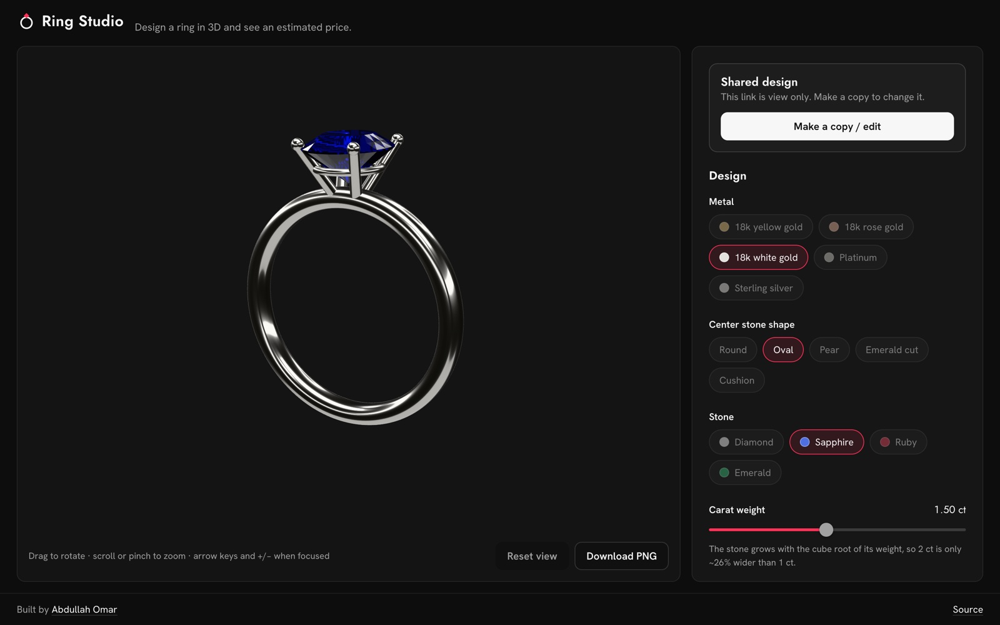

# Ring Studio

**Design a ring in 3D and see an estimated price.**

Ring Studio is a browser-based ring configurator. Pick a metal, a center stone, its cut and carat, a setting, the band's width and profile, and a finger size. The 3D ring rebuilds instantly, a live estimate shows what it might cost and why, and **Save & share** turns the design into a view-only link anyone can open.

**Live demo:** [ring-studio-aomar.web.app](https://ring-studio-aomar.web.app)

## Why it's interesting technically

- **Every piece of the ring is generated in code.** There are no model files. Stones are lofted from a girdle outline (round, oval, pear, emerald, cushion) into a table, crown, girdle and pavilion. Brilliant cuts interleave facet rings by half a segment to form star and lower-girdle facets. Step cuts keep concentric planar steps. The band is a superellipse cross-section turned on a lathe, so one exponent switches between a flat and a court (comfort-fit) profile. Bezels are a closed profile swept around the stone's outline, and prongs are placed along the same outline.
- **The geometry is physically sized.** Ring size maps to inner diameter with the US standard (`d = 11.63 + 0.8128 × size` mm). Stone width follows the cube root of carat weight, and elongated or square outlines are resized to keep the same volume as an equivalent round stone. As a check, the generated 1 ct round diamond mesh comes out at about 0.96 ct when its volume is multiplied by diamond's density.
- **The price is computed from that geometry, not from a lookup table.** Metal weight comes from the band's real cross-section area (shoelace formula) swept around the finger (Pappus's centroid theorem), plus an estimate for the head, multiplied by the alloy's density. A "How this is estimated" panel shows every assumption.
- **The lighting is procedural.** A studio of drei `<Lightformer>` cards is rendered once into the environment map, so nothing is downloaded (no HDR files), and gems get crisp glints. Gems use `MeshPhysicalMaterial` with transmission, a per-stone index of refraction (diamond 2.42, sapphire and ruby 1.77, emerald 1.58), attenuation color and dispersion.
- **It's built to run well on phones.** The three.js viewer is lazy-loaded in its own chunk, so the controls are usable before it arrives. The canvas renders continuously only while it auto-rotates; after the first interaction it switches to on-demand frames. Device pixel ratio is clamped to [1, 2]. PNG export renders one fresh frame and copies it in the same task, so the canvas never needs `preserveDrawingBuffer`. Firebase loads only when someone saves or opens a shared link.
- **Sharing is locked down.** Firestore security rules allow exactly one operation besides reading a single design by id: creating a document with exactly the expected keys, each with the right type and an allowed enum value or range, and `createdAt == request.time`. Listing, updating and deleting are denied. The client validates the same schema before writing and again after reading.

## Features

- Rotate and zoom the 3D ring (orbit controls with damping and distance limits). It auto-rotates slowly until you interact, and stays still if you prefer reduced motion.
- Metals: 18k yellow, rose and white gold, platinum and sterling silver, with physically based colors and roughness.
- Center stone: round, oval, pear, emerald cut or cushion; diamond, sapphire, ruby or emerald; 0.25 to 3.00 ct.
- Settings: 4-prong, 6-prong (with gallery rail) or bezel.
- Band: 1.5 to 4 mm wide, flat or court profile, US sizes 4 to 12 in half sizes.
- Four presets: Classic solitaire, Oval sapphire, Rose gold pear and Emerald bezel.
- Live price estimate with a metal, stone and labor breakdown, clearly labeled as sample prices.
- Save & share: stores only the configuration values and gives you a `/d/<id>` link. Shared designs open read-only, with a **Make a copy / edit** action.
- Download the current view as a PNG.
- Responsive: a side panel on desktop and a bottom sheet over a sticky 3D view on phones.
- Accessible: native radio groups and range inputs, visible focus rings, a skip link, labeled regions, a text description of the 3D view, and keyboard orbit and zoom (focus the view, then use the arrow keys, + and −).

## Stack

- React 19 and TypeScript (strict), built with Vite
- three.js through @react-three/fiber and @react-three/drei
- Firebase JS SDK v12 (Cloud Firestore) for shared designs
- Firebase Hosting (free Spark plan)
- Plain CSS with design tokens; Jost and Hanken Grotesk via Fontsource

## Project structure

```
src/
  components/      UI: controls, pricing, share, layout, and the 3D viewer
    viewer/        Canvas, lighting, band, gem, prong and bezel meshes
  hooks/           routing, saving and loading designs, clipboard, materials
  lib/
    geometry/      stone outlines, faceting, band profile, bezel and prong layout
    pricing/       sample price constants and the estimate calculation
    firebase/      config, Firestore client, designs repository
```

## Running locally

Requires Node.js 20 or newer.

```bash
npm install
npm run dev        # http://localhost:5173
```

The configurator works without Firebase. Saving and opening shared links show a friendly "not configured" state until you add a project:

```bash
cp .env.example .env.local
# fill in the VITE_FIREBASE_* values from your Firebase project's web app settings
```

Other scripts:

```bash
npm run typecheck  # TypeScript project build, no emit
npm run build      # type-check, then production build into dist/
npm run preview    # serve the production build locally
```

## Deployment (Firebase Hosting, free plan)

Ring Studio uses only Firestore and Hosting, both available on the free Spark plan. It uses no Cloud Functions, Storage or Auth.

1. Create a Firebase project, add a web app, and create a Cloud Firestore database.
2. Put the web app config in `.env.local` (see above). These values are public client identifiers; the security rules are what protect the data.
3. Link the hosting target `ring-studio` to your site, then build and deploy the site:

```bash
firebase use --add                                  # choose your project
firebase target:apply hosting ring-studio <site-id>
npm run build
firebase deploy --only hosting:ring-studio
```

4. Deploy the Firestore security rules. Rules apply to the whole database, not to one app:
   - **Dedicated project** (only Ring Studio uses it): `firebase deploy --only firestore:rules`.
   - **Shared project** (other apps use the same Firestore): do not deploy this file on its own, because it would replace the other apps' rules and their writes would start failing. Copy the `match /designs/{designId}` block and the `isValidDesign` function into the project's combined rules file and deploy that one.

`firebase.json` serves `dist/` as a single-page app (every path rewrites to `/index.html`, so `/d/<id>` links work). Hashed files under `/assets/` are cached for a year. The HTML responses (`/`, `/index.html` and `/d/**`) are always revalidated, so a new release is picked up right away.

**Known limitation: anonymous writes.** Anyone can create a design without signing in, which is what makes sharing frictionless. The rules strictly validate every document, but they cannot rate-limit, so a script could use up the free plan's daily write quota (which, in a shared project, would also stop the other apps from writing until the quota resets). Enabling [Firebase App Check](https://firebase.google.com/docs/app-check) with reCAPTCHA v3, which works on the free plan, and enforcing it for Firestore would close this gap.

## About the prices

All prices are **illustrative samples**, not live market data or a quote. They exist to show how an estimate can be derived from the design: metal weight × sample price per gram, carat × sample price per carat × a size premium, plus labor.

## Screenshots



## Author

Built by [Abdullah Omar](https://abdullah-omar-portfolio.netlify.app/).
